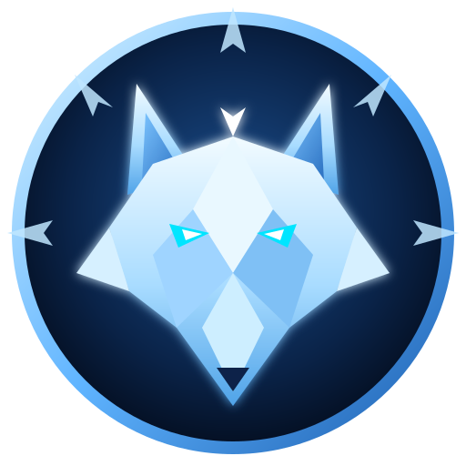

# Project Icewolf – Getem Edition

**A private, fast and debloated browser with a frost-blue look.** 
Built on the LibreWolf engine, with the **Getem** video downloader built in. No telemetry, no AI, no accounts, no clutter.

**[⬇ Download the latest version](../../releases/latest)**

Just want the browser? Use the main <b>Project Icewolf</b> repository, which has no Getem.

---

## ❄ Why Icewolf?

Most browsers send usage data home, push accounts and AI features, and fill the start page with news and sponsored tiles. Icewolf takes the privacy-focused **LibreWolf** browser and strips it down even further:

| | |
|---|---|
| 🔒 **Zero telemetry** | Built out of the engine by LibreWolf and locked off a second time by Icewolf. |
| 🧹 **Debloated** | No AI, no Mozilla account or Sync, no password manager, no translation, no Pocket, no promos. |
| 🛡 **Ad & tracker blocking** | uBlock Origin built in, strict tracking protection, HTTPS-only, encrypted DNS. |
| 🔍 **DuckDuckGo** | Default search, straight from the address bar. |
| 🧊 **Empty start page** | Just the Icewolf logo. No shortcuts, sponsors, news or ads. |
| 🌙 **Dark mode** | One click in the main menu. |
| 🔥 **Forget button** | A flame in the toolbar wipes your recent browsing data. |
| 💼 **Portable version** | Runs from any folder or USB stick, no installation needed. |
| 🔄 **Automatic updates** | New LibreWolf security updates are checked, verified and installed automatically. |
| 🎬 **Getem built in** | Search and download videos inside a browser tab. One click on the red **G** sends the current video to the download queue. |

---

## ⬇ Download & install

Go to **[Releases](../../releases/latest)** and pick one:

| File | For |
|---|---|
| `IcewolfSetup-<version>.exe` | **Installer**: installs Icewolf with a Start menu entry and automatic updates. |
| `IcewolfPortable-<version>.zip` | **Portable**: extract anywhere and start `Icewolf.exe`. Nothing is installed. |
| `IcewolfSetup-Getem-<version>.exe` | **Installer with Getem** |
| `IcewolfPortable-Getem-<version>.zip` | **Portable with Getem** |

> **"Windows protected your PC"?** The setup isn't code-signed (a certificate costs money), so Windows warns about it. Click **More info → Run anyway**. Each file has a `.sha256` checksum so you can check that your download wasn't altered.

**Import your bookmarks** from Chrome, Edge, Brave, Opera or Vivaldi: *Settings → General → Import browser data*.

---

## 🎬 Getem: video search & download

The **"Getem"** versions include Getem, a video search and download tool that lives right inside Icewolf.

| | |
|---|---|
|  **One-click button** | On a video page (YouTube, TikTok, …), click the red **G** next to uBlock Origin. The link goes straight into Getem's download queue, and Getem opens in a tab if it isn't open yet. The button turns **green** when the video is queued and **red** with an explanation if something went wrong. |
| 📑 **Getem in a tab** | **Main menu (☰) → Getem** opens Getem inside Icewolf. The Start menu entry opens it in its own window. |
| 📁 **Downloads** | Saved to `Downloads\Getem` by default. You can change the folder in Getem. |
| 🐍 **Requirement** | [Python 3.10+](https://www.python.org/downloads/) (tick *"Add Python to PATH"* during setup). On the first start, Getem installs its download components once; a window shows the progress. |
| 🔐 **Safe by design** | Getem runs as a small local server that is only reachable from your own PC (`127.0.0.1`) and needs a new random key on every start. Websites can't talk to it. It stops by itself when it's no longer used. |

> ⚖ **Use responsibly.** Getem is meant for private copies of content you're allowed to download. Respect copyright and each service's terms. Getem doesn't bypass copy protection (DRM).

---

## 🧹 What's removed

| Area | Status |
|---|---|
| Telemetry | Removed by LibreWolf and locked off by Icewolf (Glean, studies, crash reports, region lookup, attribution) |
| Mozilla account / Sync | Removed: disabled, locked and hidden |
| Password manager & autofill | Removed: disabled, locked and hidden |
| AI | Removed: chatbot, link previews, smart tab groups, AI history search, Google Lens |
| Start page & new tab | Empty except for the Icewolf logo |
| Translation, "More tools", default-browser prompt | Removed and hidden |
| Other bloat | Firefox View, Pocket, screenshots, shopping checker, Reader View, promos, push notifications, autostart |
| Branding | Icewolf everywhere: window, taskbar, About, Settings and Windows prompts |

All settings are **locked**, so updates can't bring anything back.

---

## 🛡 Privacy & security

- **Blocking:** uBlock Origin (with malware and phishing lists) plus strict tracking protection.
- **Connections:** HTTPS-only mode, encrypted DNS (Quad9), no WebRTC IP leaks, TLS 1.2+.
- **Hardening:** strict certificate pinning, no JavaScript in PDFs, add-ons injected by other programs are blocked.
- **Fingerprinting:** Firefox's fingerprinting protection is on. LibreWolf's stricter "resist fingerprinting" mode is off, because it breaks dark mode and time zones.
- **Verified engine:** every build and every update checks LibreWolf's official checksum and digital signatures. If anything doesn't match, it stops.
- **The only connections left:** engine updates, uBlock filter lists, security blocklists and encrypted DNS. None of them sends browsing or usage data.

---

## 💡 Good to know

- **Logged out after closing?** Cookies are deleted when Icewolf closes (a LibreWolf default). To stay logged in: *Settings → Privacy & Security* → untick deleting cookies on close.
- **Netflix / Spotify don't play?** DRM is off by default: *Settings → General → Play DRM-controlled content*.
- **A 3D site or game doesn't load?** WebGL is off for privacy. Set `webgl.disabled` to `false` in `user.js`.
- **Pin to taskbar:** open the Start menu, right-click **Icewolf**, choose **Pin to taskbar**.
- **Getem problem?** Errors appear in a message box. For details, send `getem-button-log.txt` (browser profile folder) plus `host-log.txt` and `server-log.txt` from Getem's `.cache` folder (installer: `%LOCALAPPDATA%\Icewolf\Getem\.cache`, portable: `getem\.cache`).

---

## 🔧 Build it yourself

No extra software needed, only Windows' built-in tools:

1. Download this repository (**Code → Download ZIP**) and extract it.
2. Double-click **`Build-Icewolf-Setup.bat`**.
3. The `dist` folder opens with all four versions (installer and portable, each with and without Getem).

The build downloads the newest signed LibreWolf release from LibreWolf's official servers and **stops unless** the checksum matches and every signature is valid. The installer checks the signatures again on each PC. If something fails, `build-log.txt` explains why.

GitHub also builds Icewolf automatically every week and for every version tag (`v1.0`, `v1.1`, …), see [`.github/workflows`](.github/workflows).

Project layout

| Path | Contents |
|---|---|
| `build.ps1`, `Build-Icewolf-Setup.bat` | Build script and one-click starter |
| `setup/` | Installer, portable launcher and updater (C#) |
| `icewolf/config/` | Browser settings: `user.js`, policies, locked prefs, theme (`userChrome.css`, `userContent.css`) |
| `icewolf/getem/`, `icewolf/getem-tab/` | Getem (Python) and its browser-tab server |
| `setup/GetemHost.cs`, `setup/getem-tab.js` | Getem launcher and the in-browser button / menu entry |
| `icewolf/branding/`, `setup/assets/` | Logo and artwork |

---

## 📜 License & credits

- **Project Icewolf** is licensed under the **[Mozilla Public License 2.0](LICENSE)**.
- **Browser engine:** [LibreWolf](https://librewolf.net), based on Mozilla Firefox (MPL 2.0). The release files contain LibreWolf's signed program files. Source code: <https://codeberg.org/librewolf>.
- **Ad blocker:** uBlock Origin (GPLv3), bundled by LibreWolf.
- **Getem** uses [yt-dlp](https://github.com/yt-dlp/yt-dlp) and other open-source Python packages, which are downloaded on first start under their own licenses.

Icewolf is an independent project and not affiliated with LibreWolf or Mozilla. Firefox is a trademark of the Mozilla Foundation.
